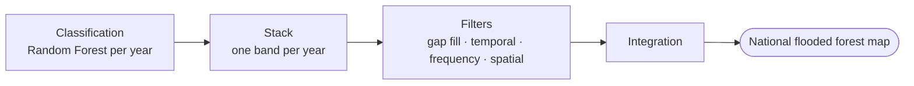

<p align="center">
  
  
</p>

# 🌊 MapBiomas Ecuador – Flooded Forest

Google Earth Engine scripts used by **MapBiomas Ecuador** ([EcoCiencia](https://www.ecociencia.org/)) to map **flooded forest** in Ecuador, year by year, from Landsat imagery. Flooded forest is one of the **cross-cutting themes** of MapBiomas Ecuador and is mapped in Collections 3 and 4.

## 🌱 What is a cross-cutting theme?

Some land-cover classes are hard to separate in the general land-cover map. For them, MapBiomas develops **cross-cutting themes**: specific methods that map **a single class of interest** independently from the general map. Other cross-cutting themes of MapBiomas Ecuador include glaciers, mining, urban infrastructure, mangroves and banana.

During the **integration** of each collection, the result of each cross-cutting theme is incorporated into the final land-cover map.

## 🌳 What is flooded forest?

A **flooded forest** is an area of natural tree vegetation larger than 0.5 ha that is flooded permanently or seasonally. Mapping it is a challenge, especially in the Amazon: from above, the canopy looks like any other forest, and the water lies underneath. For this reason, the classification combines Landsat bands with water and moisture indices (MNDWI, Tasseled Cap wetness) and terrain data (altitude, slope), and is limited to a **region of interest (ROI)** where flooded forest can occur.

| Class | Value |
|---|---|
| Flooded forest | `6` |
| Other | `27` |

More details in the Algorithm Theoretical Basis Document (ATBD): [ecuador.mapbiomas.org/atbd](https://ecuador.mapbiomas.org/atbd/).

## 🗂️ Collections

| Collection | Folder | Period | Status |
|---|---|---|---|
| Collection 3 | [`collection_3/`](collection_3/) | 1985–2024 | Published |
| Collection 4 | [`collection_4/`](collection_4/) | 1985–2025 | Published |

## 🔁 Method

Both collections classify flooded forest with **Random Forest**, region by region, and then apply post-classification filters to the time series.



| Step | Collection 3 | Collection 4 | What it does |
|---|---|---|---|
| Classification | `P01-classification.js` | `P01-classification.js` | Random Forest per year inside the ROI |
| Stack | `P02-stackMultiband-gapfill.js` | `P02-stack-multiband.js` | One image with a band per year |
| Gap fill | (in P02) | `P03-gapfill-filter.js` | Fills years with no data |
| Temporal filter | `P03-temporal-filter.js` | `P04-temporal-filter.js` | Removes short, implausible changes |
| Frequency filter | `P04-frequency-filter.js` | `P05-01-frequency-id27-filter.js`, `P05-02-frequency-id6-filter.js` | Keeps classes that persist over time |
| Spatial filter | `P05-spatial-filter.js` | `P06-spatial-filter.js` | Removes small isolated patches |
| Integration | – | `P08-integration.js` | National map |

### Filters

| Filter | What it does |
|---|---|
| **Gap fill** | Fills missing data using the class of nearby years. |
| **Temporal** | Looks at 3 to 5 consecutive years and corrects interruptions of 1 to 3 years, plus the first and last years of the series. |
| **Frequency** | If a class is present in a large share of the years, the pixel takes that class in every year. |
| **Spatial** | Patches smaller than 20 pixels take the most frequent class around them. |

## 📂 Repository structure

```
ecuador-floodable/
├── readme.md                          # This page
├── collection_3/                      # Collection 3
│   ├── P01-classification.js
│   ├── P02-stackMultiband-gapfill.js
│   ├── P03-temporal-filter.js
│   ├── P04-frequency-filter.js
│   └── P05-spatial-filter.js
└── collection_4/                      # Collection 4
    ├── README.md                      # Detailed description of each step and versions
    ├── P01-classification.js
    ├── ...
    └── P08-integration.js
```

## 🚀 How to use

1. Get a [Google Earth Engine](https://earthengine.google.com/) account and open the [Code Editor](https://code.earthengine.google.com/).
2. Choose the collection and open its scripts in order, or paste them into new scripts.
3. Edit the parameters at the top of each script and click **Run**.


## 🔗 Related

- MapBiomas Ecuador land-cover and land-use scripts (general map): `ecuador-lulc` repository.
- MapBiomas Ecuador platform: [ecuador.mapbiomas.org](https://ecuador.mapbiomas.org/).

## 👥 Authors

MapBiomas Ecuador team (EcoCiencia), with the MapBiomas Amazonía / RAISG development team.

### Contact and more information

This initiative is part of the MapBiomas Network, coordinated by MapBiomas Ecuador. More information at [ecuador.mapbiomas.org](https://ecuador.mapbiomas.org/).
