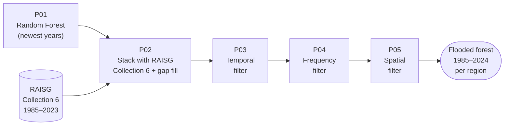

<p align="center">
  
  
</p>

# 🌊 Flooded Forest – Cross-cutting Theme (Collection 3)

Scripts used by **MapBiomas Ecuador – Collection 3** to map **flooded forest** (class `6`) from 1985 to 2024, with Landsat mosaics and Google Earth Engine. The result has two classes: flooded forest (`6`) and other (`27`).


## 🌎 Overview

In Collection 3, the time series 1985–2023 comes from the **MapBiomas RAISG Collection 6** (flooded forest remapped to 6, everything else to 27). The newest year, **2024**, is classified with Random Forest and added to that series. The complete series is then filtered. Each script runs for **one flooded region** at a time (field `id_regionC`).



| Class | Value |
|---|---|
| Flooded forest | `6` |
| Other | `27` |

## 🔍 How each step works

| Script | What it does |
|---|---|
| **P01 – Classification** | Random Forest (50 trees) for the years in `years` (default 2022–2024), inside the ROI of the region. The mosaic is the median of all satellites of the year, with 51 variables: terrain (altitude, slope), spectral indices (MNDWI, NDVI, NDWI, MMRI, clay ratio…) and Tasseled Cap (brightness, greenness, wetness). Patches smaller than 8 pixels are removed. Optional polygons add samples, extend the ROI or change classes. Exports one image per region with a band per year. |
| **P02 – Stack + gap fill** | Takes all the years of the RAISG Collection 6 (6 = flooded forest, any other class = 27) and adds the newest year (`year`, 2024) from P01. Where the new year has no value, it takes the class of the last year of Collection 6. |
| **P03 – Temporal filter** | Corrects short interruptions of class 6 (windows of 3, 4 and 5 years; 4 and 5 are optional) and the first and last years of the series (class 6 for the first year; 6 and 27 for the last). |
| **P04 – Frequency filter** | Pixels that are 6 in more than `majorityPercent` (60 %) of the years become 6 in every year. Years can be excluded, and the filter can be limited to a polygon (`applyArea`). |
| **P05 – Spatial filter** | Year by year, patches of 20 pixels or fewer (8 directions) take the most frequent class of a 3 × 3 window. |

**Temporal filter example** (middle years, class 6):

```
6 27 6         ->  6 6 6           (3-year window)
6 27 27 6      ->  6 6 6 6         (4-year window)
6 27 27 27 6   ->  6 6 6 6 6       (5-year window)
```

**Frequency filter example** (40 years, 60 % = 24 years):

```
6 6 27 6 ... 6   (30 years of 6, 75 %)  ->  6 in every year
6 27 27 6 ... 27 (15 years of 6, 37.5 %) ->  unchanged
```

## 📂 Scripts

All assets are under `projects/mapbiomas-ecuador/assets/MAPBIOMAS-LULC/COLLECTION3/CROSS_CUTTING_THEMES/FLOODABLE/`.

| Script | Input | Output |
|---|---|---|
| [`P01-classification.js`](P01-classification.js) | ROI (`STEP01-ROIS/<region>-1`), samples (`STEP02-SAMPLES/FLOODED-<region>-<year>-1`), mosaics | `STEP03-CLASSIFICATION/classification/FLOODED-<region>-<v>` |
| [`P02-stackMultiband-gapfill.js`](P02-stackMultiband-gapfill.js) | Output of P01, RAISG Collection 6 integration | `STEP03-CLASSIFICATION/clasificacion-ft/FLOODED-<region>-<v>` |
| [`P03-temporal-filter.js`](P03-temporal-filter.js) | Output of P02 | same folder |
| [`P04-frequency-filter.js`](P04-frequency-filter.js) | Output of P03 | same folder |
| [`P05-spatial-filter.js`](P05-spatial-filter.js) | Output of P04 | same folder |

### Versions

Default versions in the scripts:

| Script | Reads | Writes |
|---|---|---|
| P01 | samples 1 | 1 |
| P02 | 1 | 2 |
| P03 | 2 | 3 |
| P04 | 4 | 5 |
| P05 | 5 | 6 |

P02 to P05 write to the **same folder** (`clasificacion-ft`), so each one needs a different version number. Adjust `inputVersion` so that each script reads the output of the previous one.

## 🚀 How to use

1. Sign in to the [GEE Code Editor](https://code.earthengine.google.com/).
2. Paste the script into a new script.
3. Set `regionId` and the versions at the top of the script.
4. P01 uses polygons drawn in the Code Editor (extra samples `id_6` / `id_27`, `include` to extend the ROI, `remap` to change classes). They are included at the top of the script as imports; replace them with your own or leave the lists empty.
5. Click **Run**, review the layers and start the export from the **Tasks** tab.
6. Run P01 → P05 for each flooded region.

## 🧰 Requirements

- A [Google Earth Engine](https://earthengine.google.com/) account.
- Input assets: MapBiomas RAISG mosaics (`projects/mapbiomas-raisg/MOSAICOS/mosaics-2`), slope position (`slppost2_30_v1`), MapBiomas RAISG Collection 6 integration, flooded regions, ROIs and training samples.
- Terrain data: ALOS World 3D (`JAXA/ALOS/AW3D30_V1_1`).

## 👥 Authors

MapBiomas Ecuador team (EcoCiencia), with the MapBiomas Amazonía / RAISG development team.

### Contact and more information

This initiative is part of the MapBiomas Network, coordinated by MapBiomas Ecuador. More information at [ecuador.mapbiomas.org](https://ecuador.mapbiomas.org/).
