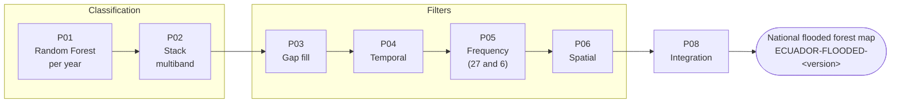

<p align="center">
  
  
</p>

# 🌊 Flooded Forest – Cross-cutting Theme (Collection 4)

Scripts used by **MapBiomas Ecuador – Collection 4** to map **flooded forest** (class `6`) year by year, from Landsat mosaics and Google Earth Engine. The result is a national map with two classes: flooded forest (`6`) and other (`27`).


## 🌎 Overview

Flooded forest is mapped separately from the general land-cover map, one **flooded region** at a time (field `id_regionC` of the flooded regions asset), and only inside the **region of interest (ROI)** of the theme, the area where flooded forest can occur. The regions are then integrated at national level.



| Class | Value |
|---|---|
| Flooded forest | `6` |
| Other | `27` |


## 🔍 How each step works

### Classification

| Script | What it does |
|---|---|
| **P01 – Classification** | Random Forest per year inside the ROI. The mosaic is the **median of all satellites of the year**, plus MNDWI, MMRI, clay ratio, Tasseled Cap (brightness, greenness, wetness), altitude and slope. Patches smaller than 20 pixels take the class of their neighbors. Optional polygons add samples, extend the ROI or change classes. Exports the classification and the samples used. |
| **P02 – Stack multiband** | Joins the annual images into one image with a band `classification_<year>` per year (optionally with years from a previous stack, e.g. Collection 3). |

### Filters

| Script | What it does |
|---|---|
| **P03 – Gap fill** | Inside the classified area, empty values become 27. Years with **no mosaic data** become gaps and take the class of the next year (or, at the end of the series, of the previous year). |
| **P04 – Temporal filter** | Removes short interruptions of a class (1 to 3 years) and fixes the first and last years. |
| **P05-01 – Frequency (27)** | Pixels that are 27 in more than 85 % of the years become 27 in every year. |
| **P05-02 – Frequency (6)** | Pixels that are 6 in more than 75 % of the years become 6 in every year. |
| **P06 – Spatial filter** | Year by year, patches smaller than 20 pixels take the most frequent class around them (5-pixel window). |

**P03 in detail** (`-` = no mosaic data):

```
Input:   6  6  -  - 27 27  -
Output:  6  6 27 27 27 27 27
```

**P04 in detail** (rules applied in the order of `filterExecution`):

```
6 27 6          ->  6 6 6           middle3
6 27 27 6       ->  6 6 6 6         middle4 + middle3
6 27 27 27 6    ->  6 6 6 6 6       middle5 + middle4 + middle3
6 27 27         ->  27 27 27        first3 (class 27, first year)
6  6 27         ->  6  6  6         last3 (class 6, last year)
```

**P05 in detail** (41 years, 1985–2025):

```
P05-01 (27, > 85 %):  27 27 6 27 ... 27   (40 years of 27)  ->  27 in every year
P05-02 (6,  > 75 %):  6 6 27 6 ... 6      (35 years of 6)   ->  6 in every year
```

### Integration

| Script | What it does |
|---|---|
| **P08 – Integration** | Mosaics the final version of every region (`REGION_VERSIONS`). Where regions overlap, the region listed last is kept. Everything else inside Ecuador becomes 27; pixels outside Ecuador are masked. |

## 📂 Scripts

| Script | Input | Output (asset folder) |
|---|---|---|
| [`P01-classification.js`](P01-classification.js) | ROI, samples (`STEP02-SAMPLES`), mosaics | `pathPrelimiarClassificationFlooded` · `FLOODED-<region>-<year>-<v>` and samples used (`pathTrainingSamplesFloodedAct`) |
| [`P02-stack-multiband.js`](P02-stack-multiband.js) | Annual images of P01 | `pathClassificationFloodedAct` · `FLOODED-<region>-<v>` |
| [`P03-gapfill-filter.js`](P03-gapfill-filter.js) | Output of P02, mosaics | `pathClassificationFloodedFilterAct` · `FLOODED-<region>-<v>` |
| [`P04-temporal-filter.js`](P04-temporal-filter.js) | Output of P03 | same folder as P03 |
| [`P05-01-frequency-id27-filter.js`](P05-01-frequency-id27-filter.js) | `STEP03-CLASSIFICATION/classification-ft` | same folder as P03 |
| [`P05-02-frequency-id6-filter.js`](P05-02-frequency-id6-filter.js) | Output of P04 | same folder as P03 |
| [`P06-spatial-filter.js`](P06-spatial-filter.js) | Output of P05 | same folder as P03 |
| [`P08-integration.js`](P08-integration.js) | Final version of every region (`classification-ft`) | `.../FLOODABLE/STEP04-INTEGRATION/ECUADOR-FLOODED-<v>` |

The asset folders (`path...`) come from the module `CollectionDirectories.js`.

### Versions

Each script reads the output of the previous one by **version number**. Default chain for one region:

| Script | Reads | Writes |
|---|---|---|
| P01 | samples 1 | 999 |
| P02 | 999 | 998 |
| P03 | 998 | 997 |
| P04 | 997 | 996 |
| P05-01 | 996 | 995 |
| P05-02 | 995 | 994 |
| P06 | 994 | 993 |
| P08 | final version of each region | 1 |


## 🚀 How to use

1. Sign in to the [GEE Code Editor](https://code.earthengine.google.com/).
2. Open the script from the repository `users/mapbiomasecuador/LULC` or paste it into a new script.
3. Set `regionId` and the versions in `PARAMS`. Each parameter is documented in place.
4. Click **Run** and compare the layers **Mosaic**, **Original** and the filtered result for the preview years. Filters also print area charts (ha) in the console: input, filtered and Collection 3. They are computed at 250 m, so use them as a reference only.
5. Start the export from the **Tasks** tab.
6. Run P01 → P06 for each flooded region, then P08 once for the whole country.

**Drawn polygons.** P01, P05-01 and P05-02 accept polygons drawn in the Code Editor (extra samples, new ROI areas, areas where the filter applies, class changes). Draw them as **FeatureCollections** and pass their names in `PARAMS`. For class changes (`remapAreas`), each feature needs the properties `from` and `to`, e.g. `from: '6'`, `to: '27'`.

## 🧰 Requirements

- A [Google Earth Engine](https://earthengine.google.com/) account.
- Code Editor modules (loaded with `require`, must be public):
  - `users/mapbiomasecuador/LULC:COLECCION4/05-modules/CollectionDirectories.js` – asset paths.
  - `users/mapbiomasecuador/LULC:MODULES/Palettes.js` – Collection 4 color palette.
- Input assets: annual mosaics (LULC step 1), flooded regions and ROIs, training samples, MapBiomas Ecuador Collection 3 map, country boundary.
- Terrain data: ALOS World 3D (`JAXA/ALOS/AW3D30_V1_1`).

## 👥 Authors

MapBiomas Ecuador team (EcoCiencia), with the MapBiomas Amazonía / RAISG development team.

### Contact and more information

This initiative is part of the MapBiomas Network, coordinated by MapBiomas Ecuador. More information at [ecuador.mapbiomas.org](https://ecuador.mapbiomas.org/).
